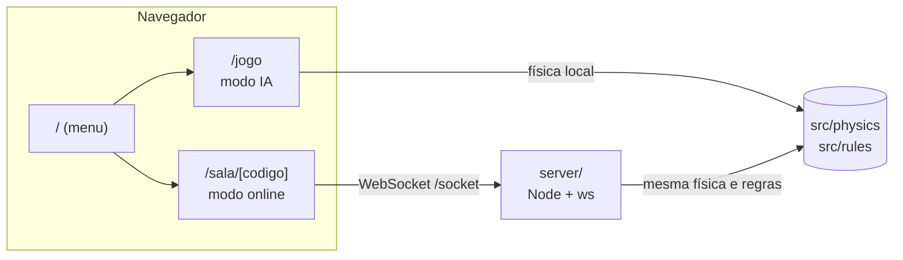

<div align="center">

# 🎱 Sinuca 3D

**Bola 8 em 3D direto no navegador — contra a IA ou contra um amigo, em tempo real.**


[Jogar agora](https://sinuca.guidev.site) · [Instalação](#-instalação) · [Como jogar](#-como-jogar) · [Arquitetura](#-arquitetura) · [Segurança](#-segurança)

</div>

---

## 📖 Sobre o projeto

Sinuca 3D é uma implementação completa de **Bola 8** que roda no navegador, sem instalar nada. A física das bolas, as regras e a IA foram escritas do zero em TypeScript, e a mesa é renderizada com [three.js](https://threejs.org).

O projeto nasceu como um jogo single-player contra a CPU e hoje também tem **salas multiplayer** com servidor autoritativo: quem decide a física é o servidor, então ninguém consegue trapacear mexendo no cliente.

### ✨ Recursos

| | |
|---|---|
| 🤖 **Contra a IA** | Joga local, sem servidor. A CPU escolhe a tacada, mira e dá o golpe. |
| 🌐 **Salas online** | Crie uma sala, compartilhe o código de 6 letras ou o link e jogue com outra pessoa. |
| 🎯 **Física própria** | Colisões bola×bola, tabelas, caçapas, atrito e rolagem, em passo fixo e determinístico. |
| 📜 **Regras da Bola 8** | Mesa aberta, lisas × listradas, faltas, bola branca na mão e vitória/derrota pela bola 8. |
| 🎥 **Duas câmeras** | Visão de cima ou câmera em primeira pessoa com mouse travado e inclinação. |
| 👀 **Mira ao vivo** | No online, você vê a mira e a posição da branca do oponente em tempo real. |
| 🔁 **Reconexão e revanche** | Caiu a conexão? Há 60 s para voltar. Terminou a partida? Peça revanche na mesma sala. |
| 🔒 **Segurança** | Validação de tudo que chega, limites de abuso, checagem de origem e container não-root. |

---

## 🚀 Instalação

### Requisitos

- **Node.js 22** ou superior
- **npm** (vem com o Node)
- Um navegador com **WebGL** (qualquer Chrome, Edge, Firefox ou Safari recente)

### 1. Clonar e instalar

```bash
git clone https://github.com/TGuiDev/sinuca_3d.git
cd sinuca_3d
npm ci
```

### 2. Rodar só o modo contra a IA

```bash
npm run dev
```

Abra <http://localhost:3000> e clique em **Jogar contra a IA**. Não precisa de mais nada.

### 3. Rodar também o modo online

O multiplayer precisa do servidor WebSocket rodando junto com o site. Em dois terminais:

```bash
# Terminal 1 — servidor de salas (porta 8787)
npm run server:build
ALLOWED_ORIGIN=http://localhost:3000 npm run server:start

# Terminal 2 — site (porta 3000)
npm run dev
```

Em `localhost` o cliente conecta automaticamente em `ws://localhost:8787/socket`. Para testar, abra duas abas (ou uma aba anônima), crie a sala em uma e entre pelo código na outra.

> **Por que `ALLOWED_ORIGIN`?** O servidor só aceita conexões vindas do site autorizado, para impedir que outras páginas usem o seu servidor. Em desenvolvimento, aponte para `http://localhost:3000`.

### Variáveis de ambiente do servidor

| Variável | Padrão | Para que serve |
|---|---|---|
| `PORT` | `8787` | Porta em que o servidor escuta. |
| `ALLOWED_ORIGIN` | `https://sinuca.guidev.site` | Única origem aceita no upgrade do WebSocket. |

### Scripts

| Comando | O que faz |
|---|---|
| `npm run dev` | Site em modo desenvolvimento. |
| `npm run build` / `npm start` | Build e execução de produção do site. |
| `npm run server:build` | Empacota o servidor com esbuild em `dist-server/server.mjs`. |
| `npm run server:start` | Inicia o servidor de salas. |
| `npm test` | Roda todos os testes (Vitest). |
| `npm run lint` | ESLint. |

---

## 🎮 Como jogar

### Escolhendo o modo

Na tela inicial há três caminhos:

- **Jogar contra a IA** — partida local, começa na hora.
- **Criar sala** — escolha um apelido; você recebe um código (ex.: `K7M2QX`) e um link para mandar ao amigo.
- **Entrar com código** — digite o código recebido e seu apelido.

Quem cria a sala **joga primeiro**. Quando o segundo jogador entra, a partida começa sozinha.

### Controles

| Ação | Como |
|---|---|
| Mirar | Mova o mouse (na câmera em 1ª pessoa o ponteiro fica travado) ou use **← →** |
| Ajuste fino da mira | **Shift** + **← →** |
| Inclinar a câmera | Mouse para cima/baixo, ou **↑ ↓** na câmera em 1ª pessoa |
| Dar a tacada | Segure o botão esquerdo, **puxe o mouse para baixo** para carregar a força e solte |
| Cancelar a força | Volte o mouse para cima até zerar e solte |
| Trocar de câmera | **V** (ou o botão no canto da tela) |
| Posicionar a branca | Clique no ponto desejado da mesa (após uma falta) |

A barra no rodapé mostra a força da tacada. Quanto mais você puxa, mais forte a bola sai.

### Regras (Bola 8)

1. **Mesa aberta:** a primeira bola encaçapada define os grupos — *lisas* (1–7) ou *listradas* (9–15).
2. **Acertou e encaçapou?** Joga de novo. Errou? A vez passa.
3. **Falta** (branca na caçapa, nenhuma bola tocada, ou tocar primeiro a bola do adversário): a vez passa e o adversário coloca a **branca na mão**.
4. **Bola 8:** só depois de encaçapar todas as suas. Encaçapou a 8 no momento certo e sem falta: **vitória**. Cedo demais ou com falta: **derrota**.

### No modo online

- **Limite de 30 s por tacada** enquanto as bolas rolam; estourou, o servidor encerra a jogada.
- **Reconexão:** se a sua conexão cair, a sala espera **60 s**. Voltando, você retoma de onde parou; se não, o oponente vence por W.O.
- **Revanche:** ao fim da partida, qualquer jogador pode pedir revanche na mesma sala.
- Você vê a **mira** e a **bola branca** do oponente enquanto ele se prepara.

---

## 🧱 Arquitetura



O projeto tem **uma única fonte de verdade** para a física e as regras (`src/physics` e `src/rules`): o modo IA usa no navegador e o servidor reutiliza o mesmo código. No online, o servidor simula, envia *snapshots* a ~30 Hz e os clientes só interpolam e desenham.

### Estrutura de pastas

```
src/
├── app/          páginas Next (menu, /jogo, /sala/[codigo])
├── components/   menu, HUD, overlays e hooks da sala online
├── game/         Game (modo IA) e OnlineGame (modo online)
├── physics/      motor de física: bolas, tabelas, caçapas
├── rules/        máquina de estados da Bola 8
├── ai/           escolha de tacada da CPU
├── render/       cena three.js, mesa, bolas, taco, câmeras
└── online/       protocolo, cliente WebSocket e interpolação
server/           servidor de salas (Node + ws)
docs/superpowers/ especificações e planos de cada etapa
```

### Servidor de salas

| Módulo | Responsabilidade |
|---|---|
| `validate.ts` | Validação em tempo de execução de toda mensagem recebida |
| `limits.ts` | Limites de taxa por conexão e por IP |
| `match.ts` | Partida autoritativa: física, regras e tempo de tacada |
| `room.ts` | Sala com 2 assentos, reconexão, W.O. e revanche |
| `rooms.ts` | Criação de salas, códigos, expiração e limites totais |
| `index.ts` | HTTP (`/health`) e WebSocket, origem, heartbeat |

### Protocolo (resumo)

| Cliente → servidor | Servidor → cliente |
|---|---|
| `criar_sala`, `entrar_sala`, `reconectar` | `sala` (código, assentos, token) |
| `tacada { angulo, forca }` | `estado` (turno, grupos, mensagem, fase) |
| `posicionar_branca { x, y }` | `snapshot` (posição das bolas) |
| `revanche`, `sair` | `erro { codigo }` (genérico) |

---

## 🔒 Segurança

O servidor **nunca confia no cliente**:

- Mensagens de até **1 KB**, com formato validado; números precisam ser finitos e a força é limitada a `[0, 1]`.
- Só o jogador da vez atira, e só na fase de mira. Posição da branca é revalidada no servidor.
- Upgrade de WebSocket apenas com a **origem autorizada** (`ALLOWED_ORIGIN`).
- Limites por conexão, por IP e totais; tentativas de entrar em sala limitadas (inviabiliza adivinhar códigos).
- Token de assento de **128 bits** (`crypto.randomBytes`), nunca enviado ao adversário.
- Códigos de sala sem caracteres ambíguos (`0/O`, `1/I/L`).
- Apelidos sanitizados e exibidos só como texto (sem XSS).
- Passos de física por ciclo limitados, para uma sala não travar as outras.
- Container como **usuário não-root**, erros genéricos, sem stack trace para o cliente.

> O IP do cliente é lido de `CF-Connecting-IP`, o que só é confiável com o servidor atrás de um proxy confiável (Traefik + Cloudflare). Não exponha a porta 8787 diretamente na internet.

---

## ☁️ Deploy

O projeto roda em dois apps no mesmo domínio, por exemplo no [Dokploy](https://dokploy.com):

| App | Build | Porta | Rota |
|---|---|---|---|
| **site** (Next) | Nixpacks, Node 22 | 3000 | `/` |
| **servidor** | `server/Dockerfile` | 8787 | `/socket` (sem remover o prefixo) |

Build da imagem do servidor (contexto na raiz do repositório):

```bash
docker build -f server/Dockerfile -t sinuca-server .
docker run --rm -p 8787:8787 -e ALLOWED_ORIGIN=http://localhost:3000 sinuca-server
curl http://localhost:8787/health
```

No site, defina `NODE_OPTIONS=--experimental-require-module` e `NIXPACKS_NODE_VERSION=22`.

---

## 🧪 Testes

```bash
npm test
```

Cobrem física, regras, IA (incluindo uma partida CPU×CPU de ponta a ponta), protocolo, limites, salas, servidor WebSocket e o cliente de rede.

---

## 🗺️ Roadmap

- [x] **Etapa 1** — menu, modo IA e salas multiplayer por código/link
- [ ] **Etapa 2** — contas, login e histórico de partidas (Postgres)
- [ ] **Etapa 3** — partidas ranqueadas, matchmaking, Elo, ranking global e antitrapaça

As especificações e os planos de cada etapa ficam em [`docs/superpowers/`](docs/superpowers).

---

## 🛠️ Stack

[Next.js 16](https://nextjs.org) · [React 19](https://react.dev) · [three.js](https://threejs.org) · [Tailwind CSS 4](https://tailwindcss.com) · [ws](https://github.com/websockets/ws) · [esbuild](https://esbuild.github.io) · [Vitest](https://vitest.dev) · TypeScript

---

<div align="center">
Feito por <a href="https://github.com/TGuiDev">TGuiDev</a> 🎱
</div>
